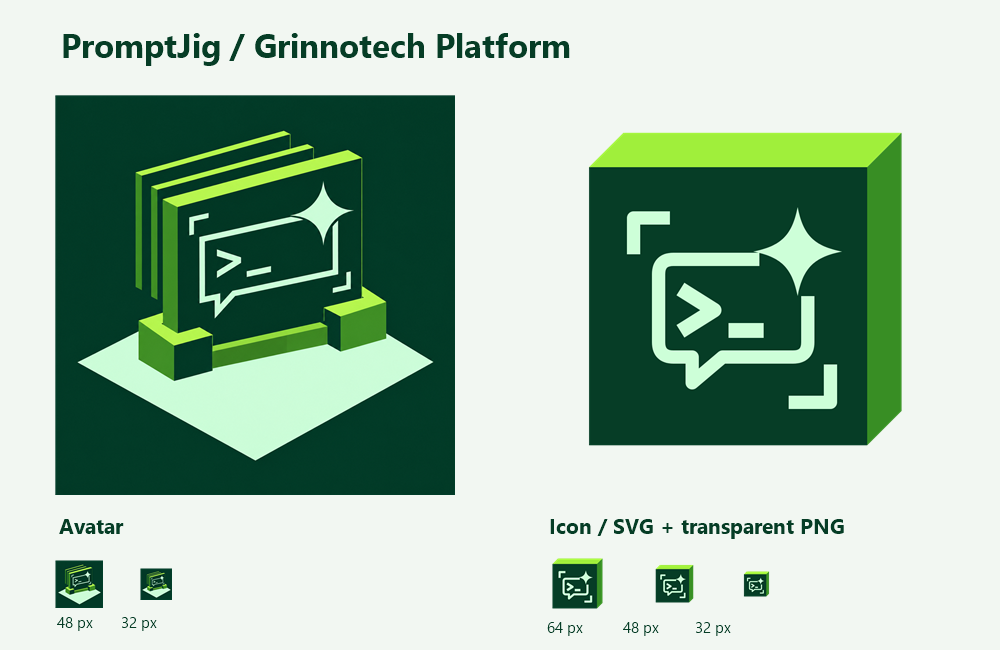

# PromptJig brand assets



The Grinnotech Platform palette and modular construction frame an AI prompt
input: a `>_` cursor, a four-point spark and two alignment corners. The cursor
identifies authored prompts, the spark suggests AI, and the fixture holds the
prompt to its explicit contract. The symbol contains no third-party product
logos. It does not imply that validation makes model calls.

## Files

| File | Use |
| --- | --- |
| [promptjig-avatar.png](promptjig-avatar.png) | 512 px square avatar. |
| [promptjig-avatar-192.png](promptjig-avatar-192.png) | 192 px repository avatar. |
| [masters/promptjig-avatar.png](masters/promptjig-avatar.png) | Full-resolution generated avatar master. |
| [promptjig-icon.svg](promptjig-icon.svg) | Scalable companion icon with transparent surroundings. |
| [promptjig-icon.png](promptjig-icon.png) | 512 px PNG icon. |
| [promptjig-icon-192.png](promptjig-icon-192.png) | 192 px PNG icon. |
| [promptjig-icon-64.png](promptjig-icon-64.png) | 64 px PNG icon. |
| [promptjig-icon-32.png](promptjig-icon-32.png) | 32 px PNG icon. |
| [preview.png](preview.png) | Avatar, icon and small-size checks. |
| [prompts.json](prompts.json) | Full generation prompt and provenance. |
| [export.ps1](export.ps1) | Reproducible PNG exports, preview and ZIP. |

## Palette and provenance

- Forest: `#063D26`.
- Lime: `#A0EF3B`.
- Side face: `#388E24`.
- Mint: `#CDFFD8`.

The avatar was generated with the built-in `image_gen.imagegen` tool, using
the Grinnotech Platform group avatar as a style reference. The SVG icon is
authored geometry adapting the avatar motif for small sizes. Preserve the
square compositions and use the compact icon where the full scene is too small.

## Reproduce exports

From the repository root on Windows with Chrome or Edge installed:

```powershell
.\assets\branding\export.ps1
```

The script renders the SVG in a dedicated hidden browser profile, then exports
proportional PNGs with native System.Drawing. It preserves the generated master
and writes `build/branding/promptjig-branding.zip` with the complete asset set.
