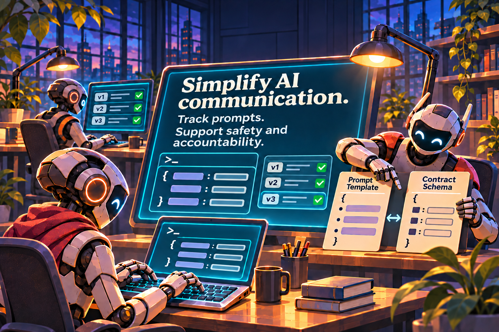






Promptjig keeps a prompt's templates, input schema and output schema in one
versioned contract. It checks them during your build, records their fingerprints
in an append-only lock and can generate Java types for your application.
The Spring AI runtime renders the same resources and validates model responses.

Start with [your first contract](getting-started.md),
or run the [small public-announcement example](examples.md).


  
{{ overview_illustration | markdownify }}

  
{{ overview_copy | markdownify }}

## Choose the pieces you need

| Component | Available version | Use it for |
| --- | --- | --- |
| [Gradle plugin](gradle.md) | {{ site.releases.gradle_plugin }}, Gradle Plugin Portal | Build-time validation, history protection and Java generation |
| Core library | {{ site.releases.runtime }}, Maven Central | Contract operations without a build-tool or Spring dependency |
| [Spring AI library](spring-ai.md) | {{ site.releases.runtime }}, Maven Central | Validated rendering and reading typed responses |
| [Maven plugin](maven.md) | {{ site.releases.maven_plugin }}, Maven Central | Build-time validation, history protection and Java generation |

These components are published separately; the current release is 0.3.1 for all
four. Applying the build plugin
does not add the runtime to your application. Adding the runtime does not
generate Java sources or check the version lock during the build.

Release 0.3.1 includes signed SBOM JSON attachments in Maven Central and a
separate SBOM JAR in Plugin Portal. See [how to download and read them](sbom.md).

## The workflow

1. Write a UTF-8 `.prompt.yaml` contract and named `.st` template resources.
2. Explicitly record a new version in `prompt-contracts.lock.json`.
3. Validate contracts and generate Java models in the build.
4. Load packaged contracts when the application starts.
5. Render named input values, call your chosen model, then validate its response.

Build-time validation and generation make no model calls. An accepted response
matches the schema; your application still decides whether its facts are correct
and whether it is suitable for use.

## Requirements

The core, runtime and generated models target Java 17. The Gradle plugin supports
Gradle 9.0+ with a JDK supported by that Gradle version. In particular, Gradle 9.0
does not run on JDK 25. The Spring AI library targets Spring AI 2.0.x, tested with
{{ site.releases.spring_ai }}. Choose a Jackson 2 or 3 binding matching your models.

The Maven adapter requires Maven 3.9+ and Java 17+; Maven 4 coverage currently
uses 4.0.0-rc-7. Development probes have separate JDK requirements and are not
required to use the published artifacts.
